<div align="center">

# ⏰ Task Reminder

### A full‑stack, offline‑capable task & reminder platform with smart notifications, analytics, and recurring workflows.

[](https://taskreminder-dun.vercel.app/)
[](https://github.com/ashrithBalaji456/Task_Reminder_Frontend)
[](https://github.com/ashrithBalaji456/Task_Reminder_Backend)


</div>

> **Note on this document:** This README was reconstructed by inspecting the actual source code in both repositories (entities, controllers, schedulers, and `package.json`/`pom.xml`), so the architecture, endpoints, and entity diagrams reflect what is really in the codebase. I did **not** have access to your deployment dashboards (Render/Railway/Neon/etc.), so exact hosting provider names are shown as placeholders — please swap them for your real providers before publishing.

---

## 📚 Table of Contents

1. [Overview](#-overview)
2. [Live Links](#-live-links)
3. [System Architecture](#-system-architecture)
4. [Tech Stack](#-tech-stack)
5. [Entity Relationship Diagram](#-entity-relationship-diagram)
6. [Core Workflows](#-core-workflows)
   - [Authentication Flow](#1-authentication-flow-jwt--refresh-tokens)
   - [Task Creation & Occurrence Generation](#2-task-creation--occurrence-generation)
   - [Reminder & Notification Pipeline](#3-reminder--notification-pipeline)
   - [Recurring Task Lifecycle](#4-recurring-task-lifecycle)
   - [Weekly / Monthly Report Pipeline](#5-weekly--monthly-report-pipeline)
   - [Offline-First PWA Sync](#6-offline-first-pwa-sync)
7. [Module / Domain Map](#-module--domain-map)
8. [API Surface](#-api-surface)
9. [Deployment Architecture](#-deployment-architecture)
10. [Getting Started Locally](#-getting-started-locally)
11. [Environment Variables](#-environment-variables)
12. [Project Structure](#-project-structure)
13. [Roadmap Ideas](#-roadmap-ideas)

---

## 🧭 Overview

**Task Reminder** is a task management system built around **time-based intent**, not just to‑do lists. Every task compiles down to one or more **occurrences** on the calendar, each occurrence can carry its own reminder policy (single push/email nudge, or a repeating nudge every *N* minutes until acknowledged), and a background scheduler continuously watches the clock to fire reminders, weekly digests, and monthly analytics reports — all while the frontend keeps working offline as an installable PWA.

**Highlights:**
- 🔐 JWT access + refresh token authentication with password reset flow
- 🗓️ One-off & recurring tasks, generating daily/weekly `TaskOccurrence` rows
- 🔔 Dual-channel notifications — **Web Push** (VAPID) and **Email** (Brevo/SMTP)
- 📊 Auto-generated weekly & monthly analytics with server-rendered charts (JFreeChart) embedded in emails
- 📴 Offline-first PWA — IndexedDB cache + background sync queue
- 🕰️ Full task movement history & audit trail (task rescheduled from date → date)
- 📈 In-app analytics dashboard (Recharts) + alerting for overdue/at-risk tasks

---

## 🔗 Live Links

| Resource | Link |
|---|---|
| 🌐 Live Application | **https://taskreminder-dun.vercel.app/** |
| 💻 Frontend Source | **https://github.com/ashrithBalaji456/Task_Reminder_Frontend** |
| ⚙️ Backend Source | **https://github.com/ashrithBalaji456/Task_Reminder_Backend** |

---

## 🏗️ System Architecture

High-level view of how the browser/PWA, API, database, schedulers, and third-party notification providers fit together.

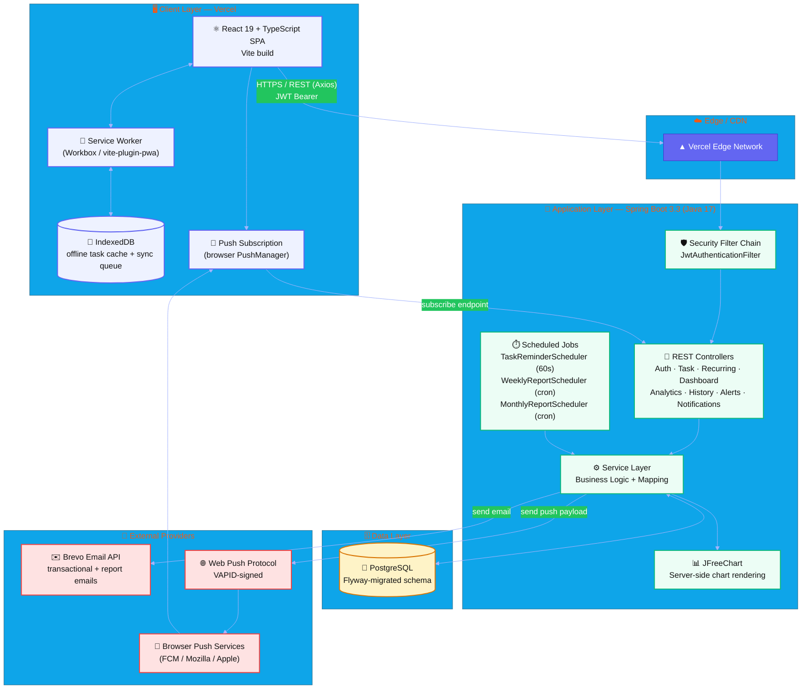

> 💡 **Animated tip:** Paste this Markdown into GitHub (native Mermaid support), Obsidian, or [Mermaid Live Editor](https://mermaid.live) — nodes render with smooth transitions and pan/zoom there.

---

## 🧰 Tech Stack

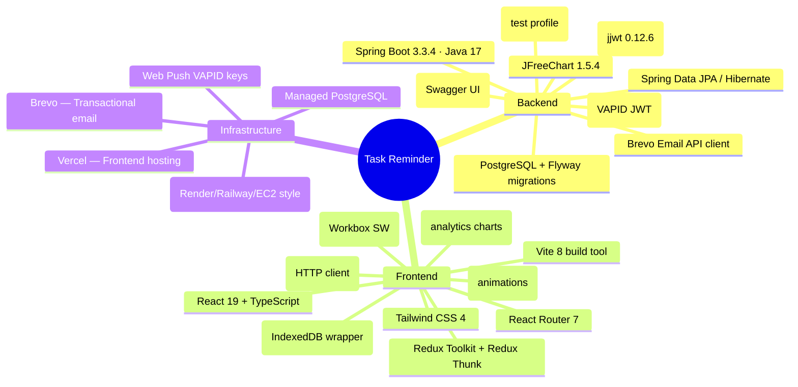

---

## 🗃️ Entity Relationship Diagram

Reconstructed directly from the JPA `@Entity` classes in `Task_Reminder_Backend`.

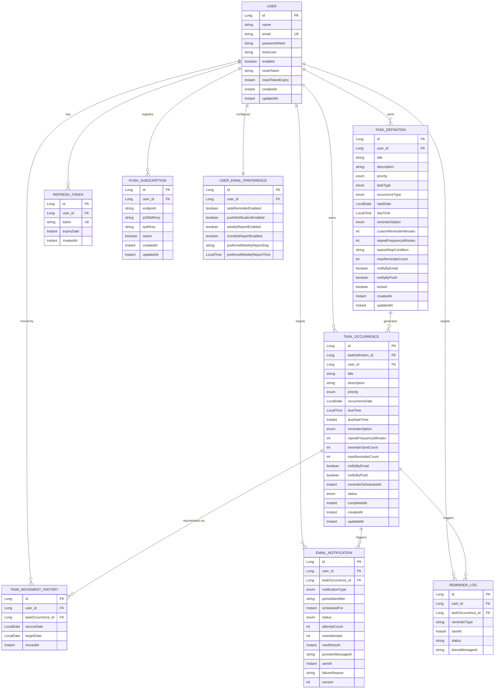

**Key design decisions visible in the schema:**
- `TASK_DEFINITION` is the *template* (especially for recurring tasks); `TASK_OCCURRENCE` is the *materialized instance* on a specific date — this is what actually shows up on the calendar and gets reminders.
- `TASK_MOVEMENT_HISTORY` gives a full audit trail every time a task occurrence is dragged/moved to another day (e.g., "move to tomorrow").
- `EMAIL_NOTIFICATION` has its own retry machinery (`attemptCount`, `maxAttempts`, `nextRetryAt`, optimistic-locking `version`) — this is a durable outbox pattern, not fire-and-forget.

---

## 🔄 Core Workflows

### 1. Authentication Flow (JWT + Refresh Tokens)

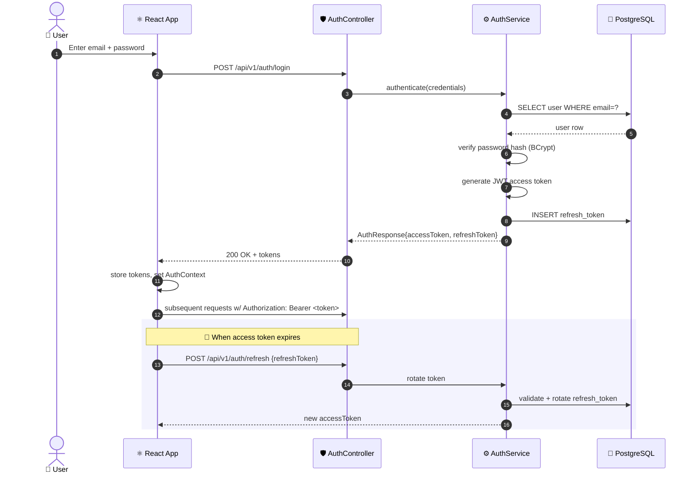

### 2. Task Creation & Occurrence Generation

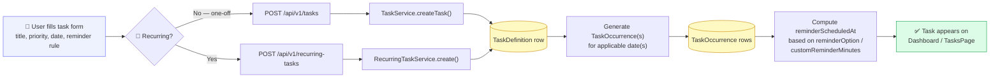

### 3. Reminder & Notification Pipeline

The heart of the system — `TaskReminderScheduler` ticks **every 60 seconds**, scanning for due reminders and routing them through the durable outbox to Email and Push channels.

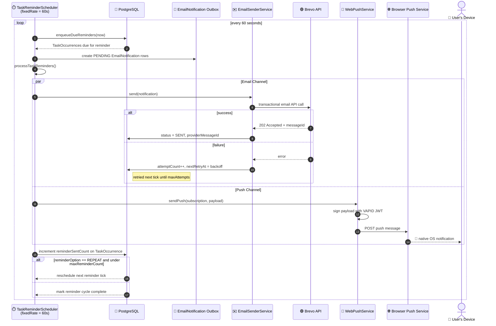

### 4. Recurring Task Lifecycle

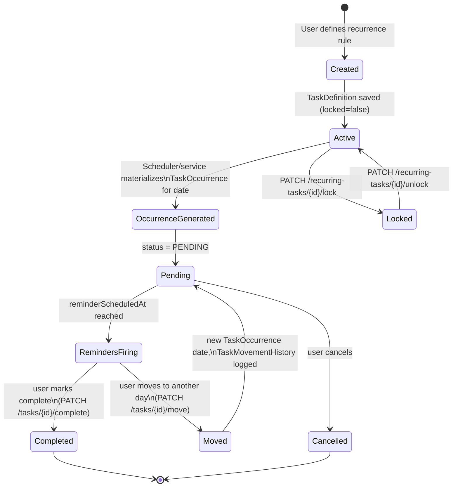

### 5. Weekly / Monthly Report Pipeline

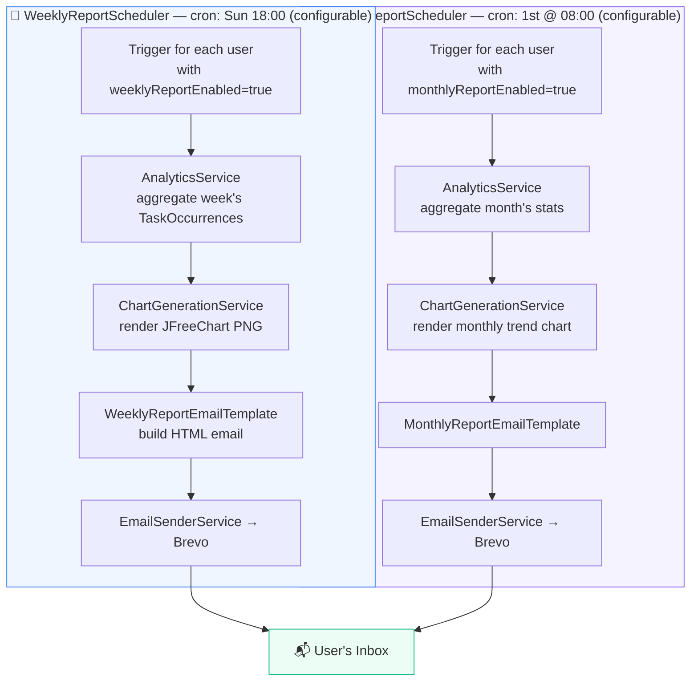

### 6. Offline-First PWA Sync

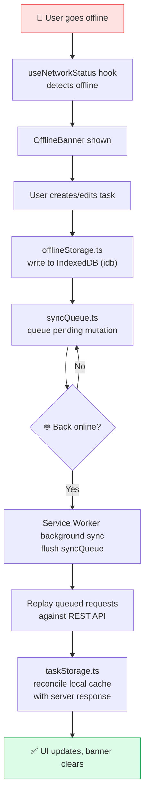

---

## 🧩 Module / Domain Map

The backend is organized as **feature-sliced packages** (not classic layered MVC) — each domain owns its controller/dto/service/entity/repository.

```mermaid
graph TD
    ROOT["com.application.taskmanager"]
    ROOT --> AUTH["🔐 auth\ncontroller · dto · entity · repository · service"]
    ROOT --> USER["👤 user\nentity · model · repository · service"]
    ROOT --> TASK["✅ task\ncontroller · dto · entity · repository · service"]
    ROOT --> RECUR["🔁 recurring\ncontroller · dto · service"]
    ROOT --> REMINDER["🔔 reminder\nentity · repository · service"]
    ROOT --> NOTIF["📮 notification\nclient · controller · dto · entity\nrepository · scheduler · service · template · util"]
    ROOT --> ANALYTICS["📊 analytics\nchart · controller · dto · service"]
    ROOT --> DASH["🧮 dashboard\ncontroller · dto · service"]
    ROOT --> HIST["🕰️ history\ncontroller · dto · service"]
    ROOT --> ALERT["🚨 alert\ncontroller · dto · service"]
    ROOT --> SEC["🛡️ security\nJWT filter · provider · UserDetailsService"]
    ROOT --> COMMON["🧱 common\nApiResponse · ErrorResponse · HealthController"]
    ROOT --> EXC["⚠️ exception\nGlobalExceptionHandler + custom exceptions"]
    ROOT --> CFG["⚙️ config\nOpenApiConfig"]

    classDef d fill:#EEF2FF,stroke:#6366F1,color:#111
    class AUTH,USER,TASK,RECUR,REMINDER,NOTIF,ANALYTICS,DASH,HIST,ALERT,SEC,COMMON,EXC,CFG d
```

---

## 📡 API Surface

All endpoints are versioned under `/api/v1`. Extracted directly from the controller annotations in the backend repo.

| Domain | Method | Endpoint | Purpose |
|---|---|---|---|
| **Auth** | POST | `/api/v1/auth/register` | Create account |
| | POST | `/api/v1/auth/login` | Login → access + refresh token |
| | POST | `/api/v1/auth/refresh` | Rotate access token |
| | POST | `/api/v1/auth/logout` | Invalidate refresh token |
| | POST | `/api/v1/auth/forgot-password` | Request reset email |
| | POST | `/api/v1/auth/reset-password` | Reset password via token |
| **Tasks** | POST | `/api/v1/tasks` | Create task |
| | GET | `/api/v1/tasks` | List tasks |
| | GET | `/api/v1/tasks/{id}` | Get task |
| | GET | `/api/v1/tasks/today` \| `/tomorrow` \| `/pending` | Filtered views |
| | PUT | `/api/v1/tasks/{id}` | Update task |
| | DELETE | `/api/v1/tasks/{id}` | Delete task |
| | PATCH | `/api/v1/tasks/{id}/complete` | Mark complete |
| | PATCH | `/api/v1/tasks/{id}/move` \| `/move/tomorrow` | Reschedule |
| **Recurring Tasks** | POST/GET/PUT/DELETE | `/api/v1/recurring-tasks` | CRUD |
| | PATCH | `/api/v1/recurring-tasks/{id}/lock` \| `/unlock` | Freeze/unfreeze template |
| **Dashboard** | GET | `/api/v1/dashboard/daily` | Daily summary |
| **Analytics** | GET | `/api/v1/analytics/weekly` \| `/monthly` | Aggregated stats |
| **History** | GET | `/api/v1/history` | Task movement / completion history |
| **Alerts** | GET | `/api/v1/alerts` | At-risk / overdue task alerts |
| **Notifications** | GET | `/api/v1/notifications` | Notification log |
| | GET | `/api/v1/push-subscriptions/vapid-public-key` | Fetch VAPID key |
| | POST/DELETE | `/api/v1/push-subscriptions` | Register/remove push device |
| | POST | `/api/v1/notifications/test/*` | Manual test triggers (reminder/push/reports) |
| **User** | GET/PUT | `/api/v1/users/email-preferences` | Notification preferences |
| **System** | GET | `/health`, `/api/v1/health` | Health check |

> 📘 Interactive API docs are available via **springdoc-openapi** at `/swagger-ui.html` when the backend is running.

---

## 🚀 Deployment Architecture

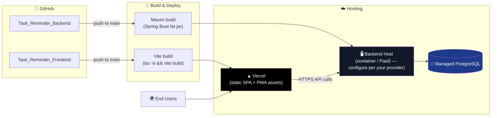

> ⚠️ **Please verify:** the diagram above shows the *shape* of the deployment. I did not have access to your actual infra dashboard, so replace "Backend Host" with your real provider (e.g. Render, Railway, Fly.io, AWS EC2) and confirm the Postgres provider name before publishing.

---

## 🛠️ Getting Started Locally

### Backend

```bash
git clone https://github.com/ashrithBalaji456/Task_Reminder_Backend.git
cd Task_Reminder_Backend

# configure src/main/resources/application.yml or environment variables
# (DB URL, JWT secret, Brevo API key, VAPID keys — see below)

./mvnw clean install
./mvnw spring-boot:run
# Backend runs on http://localhost:8080 by default
```

### Frontend

```bash
git clone https://github.com/ashrithBalaji456/Task_Reminder_Frontend.git
cd Task_Reminder_Frontend

npm install
npm run dev
# Frontend runs on http://localhost:5173 by default (Vite)
```

---

## 🔑 Environment Variables

> These are inferred from the dependencies and service classes present in the backend (JWT, Postgres, Flyway, Brevo, VAPID). Please confirm exact variable **names** against `application.yml` / `application.properties` in the backend repo, since that file wasn't included in the uploaded archive.

| Variable | Used For |
|---|---|
| `SPRING_DATASOURCE_URL` / `USERNAME` / `PASSWORD` | PostgreSQL connection |
| `JWT_SECRET` | Signing JWT access/refresh tokens |
| `BREVO_API_KEY` | Transactional email sending |
| `VAPID_PUBLIC_KEY` / `VAPID_PRIVATE_KEY` | Web Push signing |
| `APP_SCHEDULER_WEEKLY_REPORT_CRON` | Overrides default `0 0 18 * * SUN` |
| `APP_SCHEDULER_MONTHLY_REPORT_CRON` | Overrides default `0 0 8 1 * *` |
| `VITE_API_BASE_URL` (frontend) | Points SPA to backend API origin |

---

## 📁 Project Structure

```
Task Reminder/
├── Task_Reminder_Backend/          # Spring Boot 3.3 · Java 17
│   └── src/main/java/com/application/taskmanager/
│       ├── auth/          # login, register, refresh, password reset
│       ├── user/          # user entity + email preferences
│       ├── task/          # TaskDefinition, TaskOccurrence, movement history
│       ├── recurring/     # recurring task templates
│       ├── reminder/      # ReminderLog + Brevo email service
│       ├── notification/  # outbox pattern: email + push + schedulers
│       ├── analytics/     # weekly/monthly aggregation + chart generation
│       ├── dashboard/     # daily summary endpoint
│       ├── history/       # historical task activity
│       ├── alert/         # overdue/at-risk task alerts
│       ├── security/      # JWT filter, provider, UserDetailsService
│       ├── common/        # ApiResponse, ErrorResponse, health check
│       ├── exception/     # global exception handling
│       └── config/        # OpenAPI/Swagger config
│
└── Task_Reminder_Frontend/          # React 19 · TypeScript · Vite
    └── src/
        ├── api/            # Axios client + endpoints
        ├── components/     # shared UI components
        ├── context/        # AuthContext, SidebarContext, ToastContext
        ├── hooks/          # useNetworkStatus, etc.
        ├── pages/          # Landing, Login, Register, Dashboard,
        │                   # Tasks, Recurring, History, Analytics,
        │                   # Alerts, Preferences, Cancelled Tasks
        ├── pwa/             # offline storage, sync queue, push service
        ├── routes/         # AppRoutes, ProtectedRoute
        └── types/          # shared TS types
```

---

## 🧭 Roadmap Ideas

- [ ] Add real-time updates via WebSocket/SSE instead of polling-based reminder checks
- [ ] Multi-device push subscription management UI
- [ ] Timezone-aware recurring task previews before saving
- [ ] Export analytics reports as downloadable PDF (in addition to email)
- [ ] Team/shared task lists

---

<div align="center">

Made with ☕, Spring Boot, and React — by **Ashrith Balaji**

[🌐 Live App](https://taskreminder-dun.vercel.app/) · [Frontend](https://github.com/ashrithBalaji456/Task_Reminder_Frontend) · [Backend](https://github.com/ashrithBalaji456/Task_Reminder_Backend)

</div>
